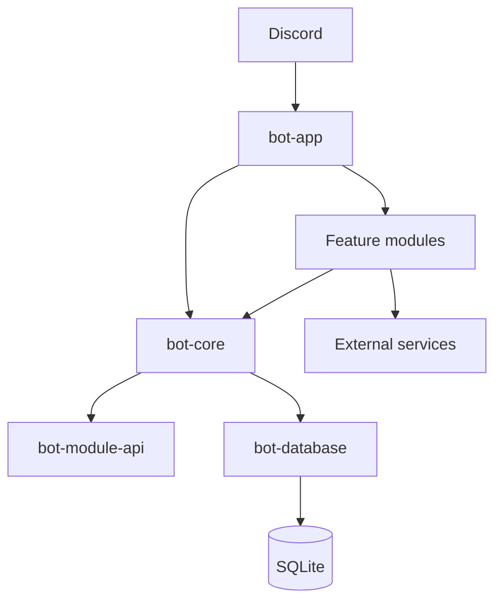

# Architecture

Momokun is a Rust 2024 workspace. The executable and internal crate names remain
`Momo`/`bot-app`. Features are separate crates so server administrators can enable
them independently without running separate bot processes.

## Repository map

| Path | Responsibility |
| --- | --- |
| `crates/bot-app` | Entry point, command composition/synchronization, startup banner, release check, shutdown |
| `crates/bot-core` | Configuration, shared replies, permissions, module registry, supervisor, channel policy |
| `crates/bot-module-api` | Small serializable contracts without Discord framework types |
| `crates/bot-database` | SQLx repository methods, migrations, transactions |
| `crates/module-*` | Commands, subscribed events, lifecycle, feature services |
| `migrations` | Forward-only numbered SQLite migrations |
| `config/example.toml` | Non-secret configuration example |
| `vendor` | Reviewed compatibility/security backports and original notices |
| `scripts` | Development, setup, and documentation tooling |
| `docs` | Public MkDocs website and contributor documentation |

Feature modules depend inward on core, database, and API crates. They do not
depend on each other. `bot-app` assembles the system; feature behavior belongs in
the relevant module.

## Startup and lifecycle

Startup loads configuration, opens SQLite and applies migrations, constructs
services, composes modules/command extensions, and initializes lifecycle hooks.
`--check` stops here without Discord login. Normal startup builds gateway intents,
connects Discord, synchronizes the application command tree, and starts reminders.

Each `module()` returns `RegisteredModule`: ID, default activation, commands,
optional extensions, gateway intents, subscribed event kinds, lifecycle, services.
The registry rejects duplicate IDs/command paths, missing extension parents, and
invalid service dependencies. Command synchronization hashes the tree to avoid
unnecessary Discord updates. `--sync-commands` forces registration.

Every command passes `bot_core::command_check`: deferred ephemeral replies,
global concurrency, shutdown state, server module activation, channel restrictions,
prefix configuration, and custom permission policy. Per-module channel limits do
not filter automatic event handlers. Do not duplicate or bypass this check.

## State and background work

SQLite stores module state, prefixes, policy rules, guild music settings,
playlists, moderation cases, reminders, bookmarks, command-sync hashes, and
module channel restrictions. Snowflakes are canonical decimal strings. SQLx
access belongs in typed database methods, with transactions for related writes.
Foreign keys, WAL mode, and a busy timeout are enabled.

The reminder scheduler wakes every 15 seconds and retains retry/recurrence state
in SQLite. Per-guild music actors own queues and voice state, with a one-second
timer for idle/empty-channel decisions. Component sessions and queues are
memory-only; restarting expires them. Music playlists and settings persist.

Long-running tasks belong under `Supervisor` with cancellation and bounded
shutdown. Music actors are the sole mutation owners of guild player state.
Shutdown cancels work, disconnects voice, and closes storage within bounded
budgets; Compose allows 20 seconds. Do not hold standard locks or Serenity cache
guards across `.await`.

## Integrations and trust boundaries

Discord HTTPS/gateway and voice UDP are core network paths. Optional services
include AniList/TMDB, DuckDuckGo/Bing, social embed providers, yt-dlp extractor
sites, Easynews, and TorBox. See [features](../features/index.md) for account and
subscription requirements. A bounded GitHub public-release check runs at ready
time and reports availability only; it does not update the bot.

Public media fetches use bounded validation, DNS pinning, timeouts and size
limits. yt-dlp, FFmpeg, and FFprobe run without a shell. Subprocess traversal has
different network guarantees from direct HTTP; review [security](../security.md)
before changing these boundaries. Credentials, signed URLs and dependency error
payloads must never reach public logs or documentation.
