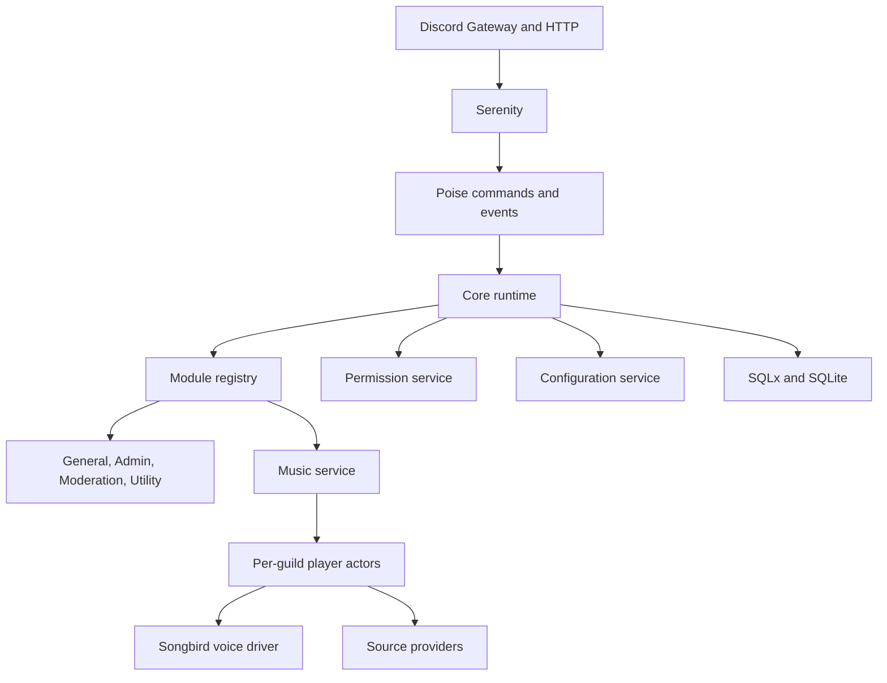
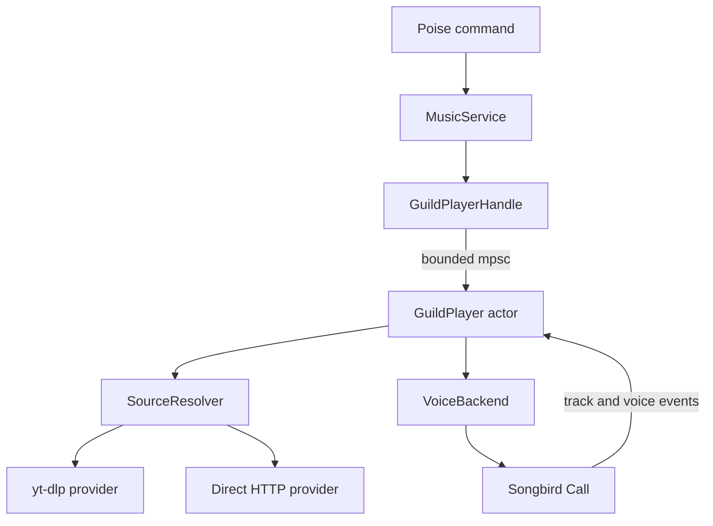

# Modular Rust Discord Bot

## Technical Specification

**Status:** Draft v0.1  
**Date:** 2026-09-20  
**Audience:** Maintainers and implementers  
**Implementation language:** Rust

---

## 1. Purpose

This document specifies a self-hosted, modular Discord bot inspired by Red-DiscordBot's useful operating model without attempting to reproduce Python's runtime import system.

The bot will provide:

- a small, stable core;
- first-party feature modules compiled as separate Rust crates;
- runtime, per-guild module enablement;
- slash commands as the canonical interface;
- optional prefix commands through Poise;
- centralized configuration and command authorization;
- a full music module built on Songbird with bot-owned queue semantics; and
- a deliberate seam for future third-party installable modules.

Version 1 is a single-process application backed by SQLite. Runtime-loaded native or WASM plugins, clustering, and a web dashboard are explicitly deferred.

### 1.1 Normative language

The words **MUST**, **MUST NOT**, **SHOULD**, **SHOULD NOT**, and **MAY** describe implementation requirements.

---

## 2. Agreed decisions

| Area | Decision |
| --- | --- |
| Runtime | Rust stable on Tokio |
| Discord API | Serenity 0.12.x |
| Command framework | Poise 0.7.x |
| Voice | Songbird 0.6.x |
| Persistence | SQLite through SQLx 0.9.x |
| Module packaging | Separate workspace crates compiled into one binary |
| Module activation | Runtime and per guild |
| Primary commands | Discord application/slash commands |
| Compatibility commands | Prefix commands, optional and disabled by default |
| Music concurrency | One Tokio actor per active guild player |
| Music queue authority | Bot-owned logical queue; Songbird is the voice/playback engine |
| Initial media resolver | `yt-dlp`, behind a source-provider abstraction |
| Third-party installables | Deferred beyond v1 |

The initial dependency line is based on Serenity 0.12.5, Poise 0.7.0, Songbird 0.6.0, SQLx 0.9.0, and Tokio 1.x. Patch updates within these compatibility lines are allowed after CI passes. The workspace lockfile MUST be committed.

---

## 3. Goals and non-goals

### 3.1 Goals

1. Keep core infrastructure independent from optional bot features.
2. Let a guild administrator enable or disable feature modules without restarting the process.
3. Let modules contribute commands, event handlers, configuration, migrations, background tasks, and typed shared services.
4. Keep all command access decisions consistent and auditable.
5. Support both slash and prefix invocation from the same Poise command definitions where practical.
6. Provide reliable music playback with isolated per-guild state and replaceable media-source logic.
7. Fail locally: one module, guild player, event handler, or media source MUST NOT crash the bot.
8. Remain straightforward to deploy on one host with one persistent data directory.

### 3.2 Non-goals for v1

- Downloading and installing third-party modules without recompilation.
- A stable Rust dynamic-library ABI.
- Multiple active bot processes sharing one database.
- PostgreSQL or MySQL support.
- A web administration dashboard.
- Voice recording, speech recognition, or the Songbird receive path.
- Persistent restoration of an active music queue after process restart.
- Spotify audio playback, autoplay/radio, audio filters, or crossfade.
- Exact behavioral compatibility with Red-DiscordBot.

---

## 4. System architecture



The core owns process lifecycle and cross-cutting policy. Modules own end-user behavior. Modules MUST NOT reach into private core state or directly mutate another module's state.

### 4.1 Process model

- One process owns one Discord bot identity.
- Serenity owns gateway shards, cache, and Discord HTTP access.
- Poise owns command parsing and dispatch.
- The core owns module registration, checks, event routing, configuration, persistence, task supervision, and shutdown.
- SQLite is local to the process and stored on a persistent volume.
- Each active music guild owns one player task and one bounded command channel.

### 4.2 Core state

The shared Poise data object SHOULD have this shape:

```rust
pub struct BotData {
    pub config: Arc<AppConfig>,
    pub database: Database,
    pub modules: Arc<ModuleRegistry>,
    pub permissions: Arc<PermissionService>,
    pub scheduler: Arc<TaskScheduler>,
    pub services: Arc<ServiceRegistry>,
}

pub type BotError = anyhow::Error;
pub type Context<'a> = poise::Context<'a, BotData, BotError>;
pub type Command = poise::Command<BotData, BotError>;
```

The concrete error implementation MAY use a typed root error instead of `anyhow::Error`, but command-facing failures MUST be classified as described in section 13.

Global mutable statics are prohibited. Shared objects MUST be passed through `BotData`, a lifecycle context, or an explicitly registered service.

---

## 5. Workspace layout

```text
.
├── Cargo.toml
├── Cargo.lock
├── rust-toolchain.toml
├── config/
│   └── example.toml
├── migrations/
├── crates/
│   ├── bot-app/
│   ├── bot-core/
│   ├── bot-module-api/
│   ├── bot-database/
│   ├── module-general/
│   ├── module-admin/
│   ├── module-moderation/
│   ├── module-utility/
│   └── module-music/
├── tests/
└── Dockerfile
```

### 5.1 Crate responsibilities

| Crate | Responsibility |
| --- | --- |
| `bot-app` | Composition root, startup, framework construction, command synchronization, signal handling |
| `bot-core` | Registry, event router, permission engine, configuration, scheduler, error handling, task supervision |
| `bot-module-api` | Stable module identifiers, metadata, dependency declarations, lifecycle contracts |
| `bot-database` | SQLx pool, migrations, transactions, and typed repositories |
| `module-*` | Commands, handlers, configuration model, services, and domain logic for one feature area |

All SQL migration files remain in one ordered top-level migration set for v1. Module tables MUST be named or otherwise documented so ownership is clear.

---

## 6. Module system

### 6.1 Module definition

Every module exports one explicit registration function:

```rust
pub fn module() -> RegisteredModule {
    RegisteredModule::builder(ModuleDescriptor {
        id: ModuleId::new_static("music"),
        display_name: "Music",
        version: env!("CARGO_PKG_VERSION"),
        required: false,
        default_enabled: false,
    })
    .commands(commands())
    .event_handlers(event_handlers())
    .lifecycle(Arc::new(MusicLifecycle::new()))
    .build()
}
```

The exact builder API is illustrative. The behavior below is normative.

Each descriptor MUST include:

- a stable, lowercase module ID;
- a human-readable name;
- a module version;
- whether it is required and therefore non-disableable;
- its default enabled state;
- owned command paths;
- subscribed Discord event kinds;
- required gateway intents;
- optional required and provided service identifiers; and
- an optional health probe.

Module IDs and command ownership MUST be unique. The process MUST fail startup on duplicate IDs, duplicate top-level slash commands, unsatisfied required services, or dependency cycles.

### 6.2 Lifecycle

The lifecycle is:

1. Load and validate process configuration.
2. Open SQLite, apply pragmas, and run migrations.
3. Construct every compiled module.
4. Validate descriptors, command names, dependencies, and intents.
5. Register and freeze shared services.
6. Run process-level module initialization.
7. Build the Poise framework and synchronize commands.
8. Connect to Discord and start supervised background tasks.
9. On shutdown, stop accepting work, cancel tasks, disconnect voice sessions, run module shutdown hooks, and close the database.

Lifecycle hooks MUST be idempotent. A module MAY implement:

- `init_process`;
- `shutdown_process`;
- `on_guild_enable`;
- `on_guild_disable`; and
- `health`.

Disabling the music module for a guild MUST stop that guild's player and disconnect its voice call.

### 6.3 Per-guild activation

Modules are present in the binary for the entire process lifetime. Enabling or disabling a module changes guild policy; it does not load or unload Rust code.

`ModuleRegistry::is_enabled(guild_id, module_id)` MUST resolve activation in this order:

1. Required modules are always enabled.
2. An explicit `guild_modules` database row wins.
3. Otherwise, the descriptor's `default_enabled` value applies.

Activation state SHOULD be cached in memory and updated only after the database transaction commits. Failed writes MUST leave the old cache value in place.

The following administrator commands are mandatory and live in the required core command set:

```text
/module list
/module info <module>
/module enable <module>
/module disable <module>
```

`/module disable core` and disabling any other required module MUST be rejected.

### 6.4 Commands and Discord visibility

All compiled slash commands are normally registered globally in production. Therefore, disabling a module per guild cannot guarantee removal of its command names from Discord's command picker.

The required behavior is:

- disabled commands are excluded from `/help` output;
- invocation is rejected by the central pre-command check;
- slash rejection is ephemeral and states that the module is disabled;
- prefix invocation is rejected without executing module code; and
- module event handlers do not receive guild events while disabled.

Per-guild slash-command registration is a possible future mode, not a v1 requirement.

### 6.5 Event subscriptions

Modules MUST explicitly register event handlers instead of receiving every Serenity event by default. The event router MUST:

- route only subscribed event kinds;
- check module activation for events associated with a guild;
- isolate and log handler errors;
- never hold a registry lock across `.await`;
- apply bounded concurrency; and
- avoid blocking the gateway task on long-running work.

Handlers that require strict ordering MUST forward events into their own actor or serial worker. Music voice-state handling follows this rule.

### 6.6 Shared services

Modules MAY expose typed services to other compiled modules through `ServiceRegistry`. Registration occurs only during startup and is immutable afterward.

The registry MUST reject duplicate service types. A module that consumes a service MUST declare that dependency in its descriptor so missing dependencies fail during startup rather than at first command use.

Direct module-to-module state imports are prohibited. Importing shared domain types or service traits is allowed.

---

## 7. Command framework

### 7.1 Invocation model

- Slash commands are canonical.
- Prefix commands MAY be generated from the same Poise command definition.
- Prefix commands are disabled by default.
- Enabling prefix commands requires the applicable gateway intents, including Message Content where Discord requires it.
- Commands that cannot complete quickly MUST defer the interaction before doing network, database, or resolver work.

Production uses global application commands. Development SHOULD use guild-scoped command synchronization for immediate updates. Supported startup modes are:

```text
commands.mode = "global"
commands.mode = "guild"
commands.mode = "none"
```

Guild mode requires an explicit allowlist of development guild IDs. The application MUST NOT bulk overwrite production commands on every reconnect; synchronization is an explicit startup action with a content hash or operator flag.

### 7.2 Central checks

Every command passes through the following checks before module logic:

1. command context is valid for DM or guild use;
2. owning module is enabled;
3. the bot has required Discord permissions;
4. the invoking member satisfies required Discord permissions and role hierarchy;
5. bot permission policy allows the command;
6. command cooldown and concurrency limits allow execution; and
7. module health permits the requested operation.

Modules MAY add stricter domain checks, such as requiring the caller to be in the same voice channel as the bot.

### 7.3 Help

`/help` MUST be generated from registered command metadata and filtered by:

- guild module activation;
- DM/guild availability;
- the caller's effective permissions; and
- owner-only or administrator-only flags.

The help system MUST support a command path such as `queue move` and identify the owning module.

### 7.4 Prefixes

When enabled, prefixes are layered as:

1. mention prefix;
2. per-guild configured prefix; then
3. process default prefix.

Prefix length MUST be constrained, blank prefixes prohibited, and prefix changes restricted to users with `Manage Guild` or an equivalent bot-owner override.

---

## 8. Authorization and permissions

Discord permissions remain authoritative for actions Discord itself protects. The bot permission service adds command-level allow and deny policy.

### 8.1 Subjects

Rules MAY target:

- everyone in a guild;
- a role;
- a user;
- a channel; or
- a role/user constrained to a channel.

Rules target either a module path (`music`) or a command path (`queue.move`). Child command rules are more specific than module rules.

### 8.2 Evaluation

The evaluator MUST be deterministic. The v1 precedence order is:

1. Bot owners bypass custom bot rules, but not Discord API constraints.
2. Guild administrators bypass custom bot rules by default.
3. A user-specific command rule.
4. A channel-specific user or role command rule.
5. A matching role command rule.
6. A user-specific module rule.
7. A channel-specific user or role module rule.
8. A matching role module rule.
9. An everyone rule.
10. The command's declared default policy.

At the same specificity, deny wins. Role matching MUST evaluate all of the member's roles rather than only the highest role.

Administrator bypass MAY be disabled process-wide for installations that need strict denies. Bot-owner recovery access MUST remain available.

### 8.3 Management commands

```text
/permissions list [command-or-module]
/permissions set <target> <allow|deny> <subject> [channel]
/permissions reset <target> <subject> [channel]
/permissions explain <command> [user]
```

`/permissions explain` SHOULD show the winning rule without exposing unrelated private data.

---

## 9. Configuration

### 9.1 Layers

Configuration resolves in this order, from lowest to highest priority:

1. compiled defaults;
2. process TOML file;
3. environment overrides;
4. guild settings stored in SQLite; and
5. temporary command arguments for the current operation.

Secrets MUST come from environment variables or an external secret mount, not SQLite or committed TOML.

Required environment support:

```text
DISCORD_TOKEN
DATABASE_URL
RUST_LOG
YT_DLP_PATH
```

Only `DISCORD_TOKEN` is always required. `DATABASE_URL` defaults to a file inside the configured data directory. `YT_DLP_PATH` defaults to `yt-dlp` resolved through `PATH`.

### 9.2 Typed configuration

Every module MUST define a typed configuration structure with defaults and validation. Arbitrary unvalidated JSON configuration blobs are prohibited.

Configuration updates MUST:

1. parse into the target type;
2. validate the complete resulting configuration;
3. persist within a transaction;
4. update the in-memory cache after commit; and
5. invoke a module change hook when live reconfiguration is supported.

Invalid configuration MUST NOT partially apply.

### 9.3 Example process configuration

```toml
[discord]
owners = []
default_prefix = "!"
prefix_commands = false

[commands]
mode = "global"
development_guilds = []

[database]
url = "sqlite://data/bot.db"
max_connections = 5

[music]
yt_dlp_path = "yt-dlp"
resolver_timeout_seconds = 30
idle_disconnect_seconds = 300
empty_channel_disconnect_seconds = 120
default_volume_percent = 100
max_queue_length = 500
max_playlist_import = 100

[logging]
format = "pretty"
```

---

## 10. Persistence

### 10.1 SQLite operation

On every connection, the database layer MUST enable foreign keys. The application SHOULD use WAL mode, a bounded busy timeout, and a small connection pool appropriate for SQLite.

Migrations run before the Discord client starts. A migration failure is fatal and MUST NOT be silently ignored.

Discord snowflake IDs MUST be stored as canonical decimal text in v1, avoiding signed-integer assumptions. Timestamps MUST use UTC Unix milliseconds unless a Discord timestamp is stored verbatim for API parity.

Modules SHOULD use typed repository APIs. Raw SQLx pool access outside `bot-database` requires an explicit architectural exception.

### 10.2 Minimum schema

```sql
CREATE TABLE guild_settings (
    guild_id              TEXT PRIMARY KEY,
    prefix                TEXT NOT NULL,
    prefix_enabled        INTEGER NOT NULL,
    locale                TEXT,
    created_at_ms         INTEGER NOT NULL,
    updated_at_ms         INTEGER NOT NULL
);

CREATE TABLE guild_modules (
    guild_id              TEXT NOT NULL,
    module_id             TEXT NOT NULL,
    enabled               INTEGER NOT NULL,
    updated_by_user_id    TEXT NOT NULL,
    updated_at_ms         INTEGER NOT NULL,
    PRIMARY KEY (guild_id, module_id)
);

CREATE TABLE permission_rules (
    id                    INTEGER PRIMARY KEY,
    guild_id              TEXT NOT NULL,
    target_path           TEXT NOT NULL,
    subject_kind          TEXT NOT NULL,
    subject_id            TEXT,
    channel_id            TEXT,
    effect                TEXT NOT NULL,
    created_by_user_id    TEXT NOT NULL,
    created_at_ms         INTEGER NOT NULL
);

CREATE TABLE moderation_cases (
    guild_id              TEXT NOT NULL,
    case_number           INTEGER NOT NULL,
    action                TEXT NOT NULL,
    target_user_id        TEXT NOT NULL,
    moderator_user_id     TEXT NOT NULL,
    reason                TEXT,
    status                TEXT NOT NULL,
    created_at_ms         INTEGER NOT NULL,
    expires_at_ms         INTEGER,
    PRIMARY KEY (guild_id, case_number)
);

CREATE TABLE reminders (
    id                    INTEGER PRIMARY KEY,
    guild_id              TEXT,
    channel_id            TEXT,
    user_id               TEXT NOT NULL,
    message               TEXT NOT NULL,
    due_at_ms             INTEGER NOT NULL,
    delivered_at_ms       INTEGER,
    failure_count         INTEGER NOT NULL DEFAULT 0
);

CREATE TABLE music_settings (
    guild_id                         TEXT PRIMARY KEY,
    dj_role_id                       TEXT,
    default_volume_percent           INTEGER NOT NULL,
    max_queue_length                 INTEGER NOT NULL,
    idle_disconnect_seconds          INTEGER NOT NULL,
    empty_channel_disconnect_seconds INTEGER NOT NULL,
    announce_now_playing             INTEGER NOT NULL
);

CREATE TABLE music_playlists (
    id                    TEXT PRIMARY KEY,
    guild_id              TEXT NOT NULL,
    owner_user_id         TEXT NOT NULL,
    name                  TEXT NOT NULL,
    created_at_ms         INTEGER NOT NULL,
    updated_at_ms         INTEGER NOT NULL,
    UNIQUE (guild_id, owner_user_id, name)
);

CREATE TABLE music_playlist_tracks (
    playlist_id           TEXT NOT NULL,
    position              INTEGER NOT NULL,
    provider              TEXT NOT NULL,
    provider_item_id      TEXT,
    canonical_url         TEXT,
    title                 TEXT NOT NULL,
    duration_ms           INTEGER,
    metadata_json         TEXT,
    PRIMARY KEY (playlist_id, position),
    FOREIGN KEY (playlist_id) REFERENCES music_playlists(id) ON DELETE CASCADE
);
```

Production migrations MAY add constraints, indexes, and supporting tables not shown here. At minimum, indexes are required for permission lookup, due reminders, moderation target history, and playlist ordering.

Active music queues are memory-only in v1. Saved playlists are persistent.

---

## 11. Initial modules

### 11.1 Core — required

Core is not disableable and provides:

```text
/help [command]
/about
/module list|info|enable|disable
/config show|set|reset
/permissions list|set|reset|explain
/prefix show|set|enable|disable
```

Bot-owner diagnostics and shutdown commands MAY exist but MUST be owner-only and MUST require an explicit confirmation for destructive operations.

### 11.2 General

```text
/ping
/avatar [user]
/user info [user]
/server info
/role info <role>
```

### 11.3 Admin

```text
/announce <channel> <message>
/slowmode <channel> <duration>
/nick <user> [nickname]
/role add <user> <role>
/role remove <user> <role>
```

All operations MUST preflight the invoking member's permissions, the bot's permissions, and Discord role hierarchy before attempting the API call.

### 11.4 Moderation

```text
/kick <user> [reason]
/ban <user> [reason] [delete-message-window]
/unban <user> [reason]
/timeout <user> <duration> [reason]
/untimeout <user> [reason]
/purge <count> [user]
/warn <user> <reason>
/warnings <user>
/case <number>
```

Moderation actions MUST create an auditable case. The recommended sequence is to create a pending case, perform the Discord action, and then mark the case succeeded or failed. A failed database update after a successful Discord action MUST be logged at critical severity and disclosed accurately to the moderator.

### 11.5 Utility

```text
/choose <options>
/poll create <question> <options>
/remind <duration-or-time> <message>
/reminders
/timestamp <time>
```

Reminder delivery is at least once. Delivery state MUST be persisted so restarts do not silently lose due reminders.

### 11.6 Music

The complete music design is normative in section 12.

---

## 12. Music module

### 12.1 User-facing scope

Required v1 commands:

```text
/play <URL-or-search>
/pause
/resume
/skip
/stop
/seek <position>
/volume <0-200>
/nowplaying
/join
/leave

/queue
/queue remove <position>
/queue move <from> <to>
/queue clear
/queue shuffle

/repeat <off|track|queue>

/playlist list
/playlist show <name>
/playlist create <name>
/playlist delete <name>
/playlist add <name> <URL-or-search>
/playlist remove <name> <position>
/playlist play <name>
```

The now-playing response SHOULD include buttons for pause/resume, skip, stop, shuffle, and repeat. Every component interaction MUST pass through the same authorization and voice-channel checks as the equivalent slash command. Component custom IDs are routing data, not proof of authorization.

### 12.2 Responsibilities



`MusicService` owns a concurrent map from guild ID to `GuildPlayerHandle`. Creation MUST be atomic so two simultaneous `/play` calls cannot create two actors for the same guild.

The `GuildPlayer` actor exclusively owns mutable playback state. Commands MUST communicate through a bounded Tokio channel rather than acquiring shared queue locks.

### 12.3 Player state

At minimum, the actor owns:

```rust
struct GuildPlayerState {
    guild_id: GuildId,
    voice_channel_id: Option<ChannelId>,
    announce_channel_id: Option<ChannelId>,
    current: Option<CurrentTrack>,
    queue: VecDeque<QueuedTrack>,
    history: VecDeque<TrackSummary>,
    repeat: RepeatMode,
    volume: f32,
    paused: bool,
    generation: u64,
    consecutive_failures: u8,
}
```

`generation` changes whenever current playback is replaced or invalidated. Resolver completions and Songbird events MUST include the generation they belong to so stale completion events cannot skip or overwrite a newer track.

### 12.4 Player commands

The actor protocol MUST support:

```rust
enum PlayerCommand {
    Join { channel: ChannelId, reply: Reply<()> },
    Enqueue { tracks: Vec<QueuedTrack>, reply: Reply<QueueReceipt> },
    Pause { reply: Reply<()> },
    Resume { reply: Reply<()> },
    Skip { reply: Reply<TrackSummary> },
    Stop { reply: Reply<()> },
    Seek { position: Duration, reply: Reply<()> },
    SetVolume { value: f32, reply: Reply<()> },
    SetRepeat { mode: RepeatMode, reply: Reply<()> },
    Shuffle { reply: Reply<()> },
    Remove { index: usize, reply: Reply<QueuedTrack> },
    Move { from: usize, to: usize, reply: Reply<()> },
    Clear { reply: Reply<usize> },
    Snapshot { reply: Reply<PlayerSnapshot> },
    Disconnect { reply: Reply<()> },
    Shutdown,
}
```

Songbird and resolver events are delivered through an internal event path:

```rust
enum PlayerEvent {
    ResolveCompleted { generation: u64, result: Result<PlayableTrack> },
    TrackEnded { generation: u64 },
    TrackFailed { generation: u64, error: PlaybackError },
    VoiceDisconnected,
    EmptyChannelTimeout,
    IdleTimeout,
}
```

The command mailbox SHOULD default to 128 messages. A full mailbox returns a friendly busy error rather than waiting without bound.

### 12.5 Queue semantics

- The bot's `VecDeque` is authoritative.
- Songbird receives only the current track in v1; it MUST NOT become the source of truth for upcoming tracks.
- Shuffle affects pending tracks only.
- `repeat track` re-resolves and replays the current logical track.
- `repeat queue` appends a completed logical track to the back of the queue.
- `stop` clears current playback and the pending queue but remains connected.
- `leave` stops playback, clears the queue, disconnects, and terminates the guild actor after cleanup.
- Queue positions shown to users are one-based; internal indexes are zero-based.
- The default queue limit is 500 tracks and is configurable per guild within process limits.

### 12.6 Source abstraction

Media resolution MUST be isolated behind a provider interface. An illustrative interface is:

```rust
#[async_trait]
pub trait AudioSourceProvider: Send + Sync {
    fn id(&self) -> &'static str;
    fn accepts(&self, input: &PlayInput) -> bool;

    async fn search(
        &self,
        query: &str,
        limit: usize,
    ) -> Result<Vec<TrackCandidate>, SourceError>;

    async fn inspect(
        &self,
        input: &PlayInput,
    ) -> Result<Vec<TrackRef>, SourceError>;

    async fn resolve(
        &self,
        track: &TrackRef,
    ) -> Result<PlayableTrack, SourceError>;
}
```

The distinction between `inspect` and `resolve` is required:

- `inspect` creates durable metadata and a canonical reference when the user queues a track.
- `resolve` runs immediately before playback and returns a short-lived playable input.

Short-lived media URLs MUST NOT be stored in playlists or treated as canonical track identity.

Initial providers:

| Provider | v1 behavior |
| --- | --- |
| `YtDlpSource` | Search, supported webpage URLs, single tracks, bounded playlist import |
| `DirectHttpSource` | Public HTTP(S) audio URLs after validation and SSRF checks |
| `LocalFileSource` | Optional, disabled by default, restricted to configured roots |

Spotify may later be added as a metadata/search provider that maps to a playable provider. Direct Spotify audio is not a v1 requirement.

### 12.7 `yt-dlp` execution

The `yt-dlp` provider MUST:

- use `tokio::process::Command` without a shell;
- pass each argument separately;
- enforce a timeout and kill the child on expiry;
- cap captured stdout and stderr;
- request structured JSON output;
- validate the number of returned entries;
- limit imported playlists to the configured maximum;
- avoid logging signed or ephemeral stream URLs; and
- surface a degraded health state when the executable is unavailable.

Resolver work MUST be limited by global and per-guild semaphores. Playback resolution SHOULD run as a tracked child task and report completion to the actor so the actor remains responsive to `stop`, `leave`, and shutdown while external resolution is in progress.

### 12.8 Songbird integration

Songbird provides Discord voice transport, track playback, events, pause/resume, volume, and seeking where supported. The integration MUST request `GUILD_VOICE_STATES`.

`VoiceBackend` SHOULD be a narrow internal trait implemented by `SongbirdVoiceBackend`, allowing actor behavior to be tested without a live Discord voice connection.

The receive feature MUST remain disabled in v1. Additional Symphonia codec features MAY be enabled when required by supported direct inputs.

Seeking MUST return a clear unsupported error when the current input cannot seek. It MUST NOT claim success based only on updating local state.

### 12.9 Voice-channel authorization

By default:

- `/play` joins the caller's current voice channel when disconnected;
- a caller must be in a voice channel;
- when already connected, the caller must be in the bot's channel for disruptive controls;
- members with the configured DJ role or `Manage Guild` MAY bypass ordinary music control restrictions;
- the bot MUST preflight Connect and Speak permissions; and
- the bot MUST not move between occupied voice channels without an authorized request.

The same rules apply to message-component controls.

### 12.10 Idle behavior and recovery

- Disconnect after the queue has remained idle for the configured duration, default 300 seconds.
- Disconnect after the configured empty-channel duration when no non-bot listeners remain, default 120 seconds.
- Cancel both timers when their triggering condition ends.
- On a playable-source failure, notify once, record the failure, and advance to the next track.
- After three consecutive track failures, stop automatic advancement and retain the pending queue for inspection.
- Reset the failure count after one track begins successfully.
- Unexpected voice disconnection MUST terminate or reset the actor cleanly; no zombie player handle may remain in `MusicService`.

### 12.11 Playlists

V1 playlists are guild-local and user-owned. Names are unique per owner within a guild. Anyone who can use music MAY play a playlist; only its owner, a guild administrator, or a bot owner may modify or delete it.

Playlist insertion and reordering MUST be transactional. Imports larger than the configured maximum MUST require truncation or be rejected; they MUST NOT silently enqueue an unbounded number of tracks.

---

## 13. Error handling

Errors MUST be separated into:

- user input errors;
- permission or policy denials;
- disabled or unhealthy feature errors;
- transient external failures;
- persistent storage failures;
- Discord API failures; and
- internal invariant failures.

User-facing messages MUST be concise and actionable. Internal errors receive a correlation ID and structured log event. Tokens, authorization headers, message content, signed media URLs, and complete resolver output MUST NOT appear in normal logs.

No command or event path may panic because of user input or an external response. Module errors are isolated by the framework-level error handler. Internal invariant failures SHOULD mark only the affected module service or guild actor unhealthy when safe recovery is possible.

---

## 14. Task supervision and shutdown

Every long-lived task MUST be owned by a supervisor and tied to a cancellation token. Detached tasks are prohibited unless they are explicitly documented as best-effort and bounded.

On `SIGINT` or `SIGTERM`, the application MUST:

1. stop accepting new background work;
2. cancel scheduler and resolver tasks;
3. request every music actor to shut down;
4. stop current tracks and disconnect voice calls;
5. wait for module shutdown hooks with a timeout;
6. flush tracing output; and
7. close the database pool.

The default graceful-shutdown budget is 15 seconds. Remaining tasks MAY be aborted after the budget expires, with a warning.

---

## 15. Security and privacy

1. Request the minimum gateway intents required by enabled process features. Privileged intents are explicit operator choices.
2. Store the Discord token only in a secret environment or mounted secret file.
3. Use parameterized SQL for all user-controlled values.
4. Never invoke media tools through a shell.
5. Bound command inputs, queues, subprocess output, resolver concurrency, HTTP body sizes, redirects, and timeouts.
6. Direct HTTP media fetching MUST reject loopback, link-local, private, multicast, and metadata-service destinations, including after redirects and DNS resolution.
7. Local-file playback is disabled by default and, if enabled, MUST canonicalize paths beneath explicit allowlisted roots.
8. Interactive components MUST re-evaluate the current caller's authorization.
9. Modifying another member MUST enforce Discord role hierarchy for both the caller and bot.
10. Voice receive and recording are absent from v1.
11. Logs SHOULD store IDs needed for diagnosis but SHOULD NOT store ordinary message content or music search queries at info level.
12. CI MUST run dependency advisories and deny known-vulnerable or unmaintained dependencies according to a reviewed policy.

---

## 16. Observability

The application MUST use `tracing` with configurable pretty or JSON output. Relevant spans SHOULD include:

- shard ID;
- guild ID;
- channel ID;
- command path;
- module ID;
- invoking user ID;
- music player generation; and
- correlation ID.

Health reporting MUST cover:

- Discord connection state;
- database connectivity;
- migration version;
- module health;
- `yt-dlp` availability;
- number of active guild players; and
- supervised task failures.

Metrics MAY initially be log-derived. A later Prometheus endpoint may expose command latency, command errors, resolver latency, queue depth, active players, playback failures, and Discord reconnects.

---

## 17. Deployment

### 17.1 Required runtime assets

- the bot executable;
- CA certificates;
- writable persistent data directory;
- Discord token;
- `yt-dlp` for the default internet media provider; and
- Songbird's required Opus support or build/runtime prerequisites.

The container image SHOULD include a known-good `yt-dlp`, while also allowing the executable path to be overridden. Operators are responsible for keeping it updated and for complying with source-service terms and local law.

### 17.2 Filesystem

```text
/app/bot
/app/config/config.toml
/data/bot.db
/data/backups/
```

The SQLite database and backup directory MUST be on persistent storage. Backups SHOULD use SQLite's online backup mechanism or a coordinated checkpoint; copying a live multi-file WAL database without coordination is prohibited.

### 17.3 Readiness

The process is ready only after configuration validation, migrations, module initialization, and framework construction succeed. A missing optional resolver may leave music degraded but MUST be visible in health output.

---

## 18. Testing and quality gates

### 18.1 Unit tests

Required coverage areas:

- configuration merge and validation;
- permission precedence and deny behavior;
- module enablement defaults and cache updates;
- command ownership and conflict detection;
- queue move/remove/shuffle/repeat transitions;
- stale music generation event rejection;
- idle and empty-channel timers with paused Tokio time;
- source input classification and canonicalization;
- SSRF address rejection; and
- moderation hierarchy checks.

### 18.2 Integration tests

- Apply all migrations to a temporary SQLite database.
- Exercise repository transactions and uniqueness constraints.
- Build the full module registry and command tree.
- Verify disabled modules cannot execute commands or guild event handlers.
- Test the player actor against a fake `VoiceBackend` and fake source provider.
- Test graceful shutdown with active tasks and guild players.
- Test `yt-dlp` parsing against stored fixture output; live network tests are optional and excluded from default CI.

### 18.3 End-to-end tests

A private test guild SHOULD validate:

- global and guild command registration;
- slash and optional prefix invocation;
- role hierarchy and permission denials;
- joining, playing, pausing, seeking, skipping, and disconnecting;
- component authorization;
- bot reconnect behavior; and
- moderation audit reasons.

### 18.4 CI gates

Every change MUST pass:

```text
cargo fmt --check
cargo clippy --workspace --all-targets --all-features -- -D warnings
cargo test --workspace
cargo deny check
```

If SQLx compile-time query macros are used, CI MUST also validate committed offline query metadata or build against a migrated disposable database.

First-party crates SHOULD forbid unsafe code. Unsafe code inside audited dependencies such as the SQLite FFI is outside that rule.

---

## 19. Delivery plan

### Milestone 1 — Foundation

- Workspace and CI.
- Configuration and tracing.
- SQLite connection and migrations.
- Serenity, Poise, and command synchronization.
- Core `help`, `about`, and error handling.

### Milestone 2 — Modular runtime

- Module descriptors and registry.
- Per-guild enable/disable.
- Event subscriptions.
- Permission service.
- General and Admin modules.

### Milestone 3 — Moderation and utility

- Moderation commands and cases.
- Reminder scheduler.
- Utility commands.
- Shutdown and health diagnostics.

### Milestone 4 — Music baseline

- Songbird registration and voice backend.
- `MusicService` and per-guild actor.
- Join, leave, play, pause, resume, skip, stop, queue, volume.
- `yt-dlp` source provider.
- Failure recovery and idle disconnect.

### Milestone 5 — Music completion

- Seek, repeat, shuffle, queue editing.
- Now-playing components.
- Persistent playlists.
- DJ role and music configuration.
- Actor and resolver load tests.

### Milestone 6 — Release hardening

- Docker image.
- Backup and upgrade documentation.
- Security review.
- Test-guild acceptance run.
- v1.0 release checklist.

---

## 20. V1 acceptance criteria

V1 is complete when all of the following are true:

1. A clean deployment can start from documented configuration and create/migrate its database.
2. Slash commands register in development and production modes without name conflicts.
3. A guild administrator can enable and disable every optional module without restarting the process.
4. Disabled commands never execute module logic and are absent from `/help`.
5. Permission rules produce deterministic, explainable decisions.
6. One guild's module or music failure does not interrupt another guild.
7. Music can resolve a search or supported URL, join voice, play, pause, resume, seek when supported, skip, stop, and disconnect.
8. Queue mutation, repeat, shuffle, and playlist operations behave according to this document.
9. Simultaneous music commands cannot create duplicate guild players or corrupt queue state.
10. Missing or failed `yt-dlp` produces a clear degraded state rather than a process crash.
11. Moderation operations enforce Discord permissions and hierarchy and generate cases.
12. SQLite data survives restart; active voice queues are intentionally not restored.
13. Shutdown disconnects active voice calls and completes within the configured budget under normal conditions.
14. All CI quality gates pass.

---

## 21. Deferred installable-plugin direction

V1 MUST NOT promise a stable native Rust plugin ABI or load arbitrary `.so`, `.dll`, or `.dylib` files.

The module ID, metadata, declared capabilities, typed service boundaries, and lifecycle model should remain suitable for a later installable-plugin system. The preferred future options are:

1. sandboxed WASM components with an explicit host API; or
2. isolated plugin processes communicating through a versioned RPC protocol.

Native dynamic libraries are not the preferred path because Rust does not provide a stable language ABI across compiler and dependency versions.

No v1 implementation choice may require future third-party plugins to access raw `BotData`, the SQLx pool, or Serenity internals directly.

---

## 22. Reference documentation

- [Serenity crate documentation](https://docs.rs/crate/serenity/latest)
- [Poise crate documentation](https://docs.rs/crate/poise/latest)
- [Songbird crate documentation](https://docs.rs/crate/songbird/latest)
- [Songbird repository and runtime dependency notes](https://github.com/serenity-rs/songbird)
- [SQLx crate documentation](https://docs.rs/crate/sqlx/latest)
- [Tokio crate documentation](https://docs.rs/crate/tokio/latest)
- [Discord application commands](https://docs.discord.com/developers/interactions/application-commands)
- [Discord gateway and intents](https://docs.discord.com/developers/events/gateway)
- [Discord permissions](https://docs.discord.com/developers/topics/permissions)

